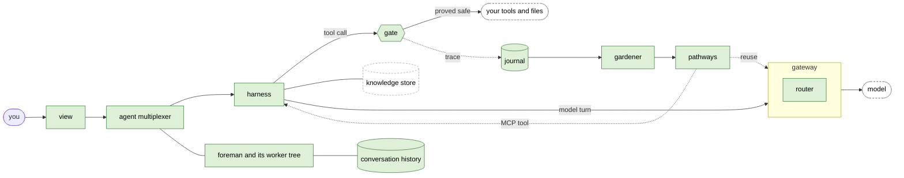
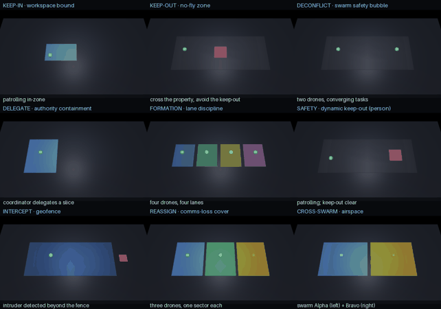

<p align="center">
  <picture>
    <source media="(prefers-color-scheme: dark)" srcset="docs/assets/logo-dark.png">
    
  </picture>
</p>

<p align="center">
  <a href="https://github.com/levitatingflyfisher/openDaisugi/actions/workflows/ci.yml"></a>
  
  
</p>

New here? [Start here](docs/start-here.md).

**openDaisugi is a JIT compiler for AI agents.** The first time, a frontier model does the
work and a proof checks every action before it runs. The tenth time, the work runs as a plain
script for free.

The idea under it: **separate what is _allowed_ from what is _decided_.** A model decides. An
envelope says what is allowed. Z3 proves each action stays inside the envelope before it runs.

## The slots

An agent stack has slots. Each piece of openDaisugi fills one. Any slot can be empty. Some slots
sit inside another: the router sits inside the gateway. Put our piece in a slot, put someone
else's there, or write your own.



Green is ours. Dashed is bring your own. The gate is optional.

## Start with one command

Each line works alone.

```bash
claude --settings "$(daisugi gate settings)"      # the gate alone (run `daisugi gate init` once first)
daisugi gateway                                   # the gateway alone; then ANTHROPIC_BASE_URL=http://127.0.0.1:8787 claude
coppice                                           # the agent multiplexer alone
```

`daisugi install --gate` makes the gate permanent. It writes five things for Claude Code: the
gate hook, a capture hook, the MCP server, the `opendaisugi-checklist` skill and a note in
`~/.claude/CLAUDE.md`. `daisugi install --uninstall` reverses all five.

## What fills each slot

Full list with links: [the landscape](docs/explanation/landscape.md).

| Slot | Ours | Others that fill it |
|---|---|---|
| Agent harness (the loop) | sprig | [Claude Code](https://code.claude.com/docs), [Codex](https://developers.openai.com/codex), [pi](https://pi.dev), [OpenCode](https://opencode.ai), [Hermes Agent](https://hermes-agent.nousresearch.com/docs) |
| Agent multiplexer | coppice | tmux, [Herdr](https://github.com/ogulcancelik/herdr), [tenex](https://github.com/Mockapapella/tenex), [graith](https://github.com/d0ugal/graith), [initech](https://github.com/nmelo/initech), [Claude Squad](https://github.com/smtg-ai/claude-squad) |
| Views (on the multiplexer) | terminal, web, phone; game skins planned (RTS first) | [Pixel Agents](https://github.com/pablodelucca/pixel-agents), [Minecraft Agent IDE](https://github.com/terminalsin/minecraft-agent-ide), [AgentCraft](https://github.com/blendi-remade/agentcraft), [AI Town](https://github.com/a16z-infra/ai-town) |
| Safety gate | `daisugi gate`: an LLM writes an envelope for the task, Z3 proves each tool call stays inside it, fail closed | harness permission rules and sandboxes ([Claude Code](https://code.claude.com/docs/en/sandboxing), [Codex](https://developers.openai.com/codex)), policy engines ([AWS AgentCore Policy](https://docs.aws.amazon.com/bedrock-agentcore/latest/devguide/policy.md), [OPA](https://www.openpolicyagent.org)), guardrails ([Lakera](https://www.lakera.ai), [Invariant Labs](https://invariantlabs.ai), [NeMo Guardrails](https://github.com/NVIDIA-NeMo/Guardrails), [LlamaFirewall](https://arxiv.org/abs/2505.03574)) |
| Sandbox | `daisugi fence`, opt-in: a Landlock ruleset around any harness, set by the kernel ([how to](docs/how-to/fence.md)) | [Claude Code /sandbox](https://code.claude.com/docs/en/sandboxing) (bubblewrap), [Codex](https://developers.openai.com/codex) (bubblewrap), Cursor (Landlock and seccomp), containers |
| Gateway, with a router slot | `daisugi gateway`; router: off, rules, switchyard, knn (learns from outcomes) or model (a model picks); a grader model can score turns | [NVIDIA NeMo Switchyard](docs/how-to/router-switchyard.md) (plugs into our router slot), [RouteLLM](https://github.com/lm-sys/RouteLLM), [Not Diamond](https://www.notdiamond.ai) |
| Worker tree | the foreman (a long chat at the root) and its tree of gated workers | [Claude Code subagents](https://code.claude.com/docs/en/subagents), [Codex subagents](https://developers.openai.com/codex/subagents), [Gas Town](https://github.com/steveyegge/gastown), [claude-flow](https://github.com/ruvnet/ruflo), OpenAI Agents SDK, CrewAI, LangGraph |
| Traces to distillation | three kinds: code (pathways), skills (gardener) and weights (QLoRA via `daisugi lora`, needs a GPU, trains the envelope writer today). Repeated work moves down a ladder from a large model to a small model to a skill to a plain script | [Hermes Agent skills](https://hermes-agent.nousresearch.com/docs), [Agent Skills](https://www.anthropic.com/engineering/equipping-agents-for-the-real-world-with-agent-skills), [Voyager](https://arxiv.org/abs/2305.16291), [GEPA](https://arxiv.org/abs/2507.19457), [ACE](https://arxiv.org/abs/2510.04618), [OpenPipe ART](https://github.com/OpenPipe/ART); idea: [do-nothing scripting](https://blog.danslimmon.com/2019/07/15/do-nothing-scripting-the-key-to-gradual-automation/) |
| Conversation history | the foreman's memory tree: the full log is kept and compacted into a summary tree you can zoom into and rewind | [OptMem and OptChat](https://github.com/VictorTaelin/OptMem) by Victor Taelin (the pattern ours follows), UniiChat, [Letta](https://github.com/letta-ai/letta) |
| Knowledge store | none: bring your own | [Mem0](https://github.com/mem0ai/mem0), [Zep and Graphiti](https://github.com/getzep/graphiti), [Cognee](https://github.com/topoteretes/cognee), [GraphRAG](https://arxiv.org/abs/2404.16130), plain RAG |

Others call these two agent memory.

Other gates use rules, sandboxes, ML detection or fixed policies. We found none that proves each
call against an envelope written for the task. That is a search result, not a proof.
The gate checks meaning, not shape: see [what it proves that schemas and rules do not](docs/explanation/modular-stack.md#the-gate-checks-meaning-not-shape).



## Go on

- [Recipes](docs/recipes/README.md): four ways to mix our pieces with others.
- [Install](AGENTS.md#install). Go is the default build. Rust is opt in:
  `DAISUGI_PORT=rust scripts/install.sh`. Python is the reference the others are checked against.
- [Honest limits](docs/limitations.md) and the [scorecard](VISION.md).
- [Docs hub](docs/README.md) and [AGENTS.md](AGENTS.md).

MIT. See [LICENSE](LICENSE).
