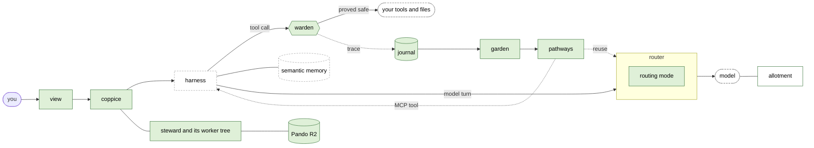
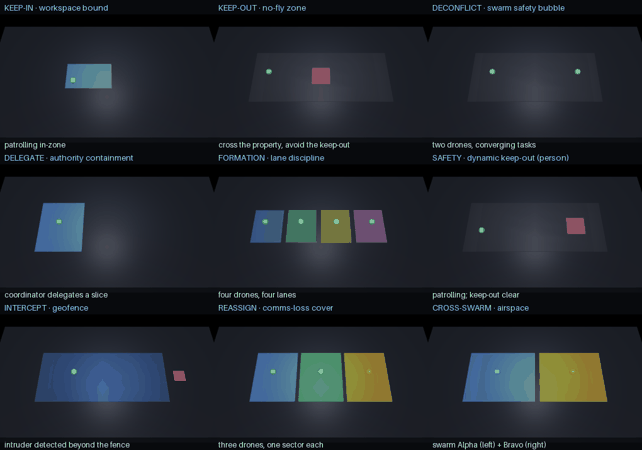

<p align="center">
  <picture>
    <source media="(prefers-color-scheme: dark)" srcset="docs/assets/logo-dark.png">
    
  </picture>
</p>

<p align="center">
  <a href="https://github.com/levitatingflyfisher/openDaisugi/actions/workflows/ci.yml"></a>
  
  
</p>

New here? [Start here](docs/start-here.md).

**openDaisugi is a JIT compiler for AI agents.** The first time, a frontier model does the
work and a proof checks every action before it runs. The tenth time, the work runs as a plain
script for free.

The idea under it: **separate what is _allowed_ from what is _decided_.** A model decides. An
envelope says what is allowed. Z3 proves each action stays inside the envelope before it runs.

## The parts

Every agent system is built from the same parts. Seen from far off, they make six layers, and
each layer answers one question about where the work goes next.

| Layer | The question it answers | Our part |
|---|---|---|
| Attention | How does one person follow many agents? | coppice: every agent on one screen |
| Context | What does this agent know, and who helps it? | memory and the worker tree: Pando R2, the journal, the steward |
| Safety | Can I do this? | the warden checks each action; the fence limits where code runs |
| Script or skill | Is there a checked set of steps already? | the garden: pathways, replayed with no model call |
| Model | Which model takes this turn? | the router; the model itself is yours |
| Hardware | Who gets the GPU now? | allotment, being built |

Each part works alone and any part can be left out. Use our part, use someone else's, or write
your own. Some parts sit inside another: the routing mode sits inside the router.



Green is ours. Dashed is bring your own. Allotment is ours and is being built. The warden is
optional.

## Start with one command

Each line works alone.

```bash
claude --settings "$(daisugi warden settings)"      # the warden alone (run `daisugi warden init` once first)
daisugi router serve                                   # the router alone; then ANTHROPIC_BASE_URL=http://127.0.0.1:8787 claude
coppice                                           # every agent on one screen, alone
```

`daisugi install` makes the warden permanent. It writes five things for Claude Code: the warden hook
in audit mode, a capture hook, the MCP server, the `opendaisugi-checklist` skill and a note in
`~/.claude/CLAUDE.md`. Audit mode records every tool call and blocks none; `daisugi install
--enforce` makes the warden deny calls outside your envelope. `daisugi install --uninstall`
reverses all five. `daisugi install --only warden` writes the warden hook alone.

## What fills each part

Full list with links: [the landscape](docs/explanation/landscape.md).

| Part | Ours | Other good choices |
|---|---|---|
| Worker tree | coppice, with the steward (a long chat at the root) and its tree of checked workers | your harness's subagents ([Claude Code](https://code.claude.com/docs/en/subagents), [Codex](https://developers.openai.com/codex/subagents)), [Gas Town](https://github.com/steveyegge/gastown), [claude-flow](https://github.com/ruvnet/ruflo), OpenAI Agents SDK, CrewAI, LangGraph |
| View | coppice: terminal, web and phone; game skins are planned | tmux, [Herdr](https://github.com/ogulcancelik/herdr), [Claude Squad](https://github.com/smtg-ai/claude-squad), [tenex](https://github.com/Mockapapella/tenex), [graith](https://github.com/d0ugal/graith), [initech](https://github.com/nmelo/initech); skins: [Pixel Agents](https://github.com/pablodelucca/pixel-agents), [AgentCraft](https://github.com/blendi-remade/agentcraft) |
| Semantic memory (facts) | none: bring your own, mounted beside daisugi as an MCP server | [Mem0](https://github.com/mem0ai/mem0), [Graphiti](https://github.com/getzep/graphiti), [Zep](https://www.getzep.com/), [Cognee](https://github.com/topoteretes/cognee), [Supermemory](https://github.com/supermemoryai/supermemory), [Hindsight](https://github.com/vectorize-io/hindsight), [Letta](https://github.com/letta-ai/letta), [LangMem](https://langchain-ai.github.io/langmem/), [GraphRAG](https://arxiv.org/abs/2404.16130), plain RAG |
| Procedural memory (how to do it) | the garden: proved pathways and skills, and with a GPU a fine-tuned small model (`daisugi lora`). Repeated work moves down a ladder from a large model to a small model to a skill to a plain script | [Hermes Agent skills](https://hermes-agent.nousresearch.com/docs), [Agent Skills](https://www.anthropic.com/engineering/equipping-agents-for-the-real-world-with-agent-skills), [Voyager](https://arxiv.org/abs/2305.16291), [GEPA](https://arxiv.org/abs/2507.19457), [ACE](https://arxiv.org/abs/2510.04618), [OpenPipe ART](https://github.com/OpenPipe/ART); idea: [do-nothing scripting](https://blog.danslimmon.com/2019/07/15/do-nothing-scripting-the-key-to-gradual-automation/) |
| Episodic memory: what agents did | the journal: every action, verdict and token count, kept across harnesses | Hermes Agent keeps past sessions in SQLite with full-text search |
| Episodic memory: what was said | Pando R2 (Reversible Recollections), in coppice: every message is kept word for word, older stretches show as summary lines, and any line opens back to the exact messages | [OptMem and OptChat](https://github.com/VictorTaelin/OptMem) by Victor Taelin (the recipe ours follows), [Hermes OptChat plugin](https://hermes-agent.nousresearch.com/docs/plugins/optchat) |
| Warden | `daisugi warden`: an LLM writes an envelope for the task, Z3 proves each tool call stays inside it, and an action it cannot prove is denied | harness permission prompts and rules, policy engines ([AWS AgentCore Policy](https://docs.aws.amazon.com/bedrock-agentcore/latest/devguide/policy.md), [OPA](https://www.openpolicyagent.org)), guardrails ([Lakera](https://www.lakera.ai), [Invariant Labs](https://invariantlabs.ai), [NeMo Guardrails](https://github.com/NVIDIA-NeMo/Guardrails), [LlamaFirewall](https://arxiv.org/abs/2505.03574)) |
| Sandbox | `daisugi fence`, opt-in: a Landlock ruleset around any harness, set by the kernel ([how to](docs/how-to/fence.md)) | [Claude Code /sandbox](https://code.claude.com/docs/en/sandboxing) (bubblewrap), [Codex](https://developers.openai.com/codex) (bubblewrap), Cursor (Landlock and seccomp), containers |
| Harness (the agent loop) | none needed: daisugi works with the harness you have, and runs on Linux, tested on Omarchy. Its own harness, sprig, is experimental and on hold | [Claude Code](https://code.claude.com/docs), [Codex](https://developers.openai.com/codex), [Hermes Agent](https://hermes-agent.nousresearch.com/docs), [pi](https://pi.dev), [OpenCode](https://opencode.ai) |
| Router | `daisugi router serve`, a proxy between harness and model; routing modes: off, rules, switchyard, knn (learns from outcomes) or model (a model picks); a grader model can score turns | [NVIDIA NeMo Switchyard](docs/how-to/routing-mode-switchyard.md) (plugs into our routing mode), [RouteLLM](https://github.com/lm-sys/RouteLLM), [Not Diamond](https://www.notdiamond.ai) |
| Model | none: bring your own, any API model or a local one | any API model; local runners such as [Ollama](https://ollama.com), [llama.cpp](https://github.com/ggml-org/llama.cpp) and llamafile |
| GPU sharing | allotment, a lease ledger in the coppice server: it decides which caller gets the graphics card next, so local models stop pushing each other off it. It is being built and is not in a release | the queue in your model server, such as Ollama's; [llama-swap](https://github.com/mostlygeek/llama-swap); [Slurm](https://slurm.schedmd.com) on a cluster |

Other checks use rules, sandboxes, ML detection or fixed policies. We found none that proves each
call against an envelope written for the task. That is a search result, not a proof.
The warden checks meaning, not shape: see [what it proves that schemas and rules do not](docs/explanation/modular-stack.md#the-warden-checks-meaning-not-shape).



## Go on

- [Recipes](docs/recipes/README.md): four ways to mix our pieces with others.
- [Install](AGENTS.md#install). Go is the default build. Rust is opt in:
  `DAISUGI_PORT=rust scripts/install.sh`. Python is the reference the others are checked against.
- [Honest limits](docs/limitations.md) and the [scorecard](VISION.md).
- [Docs hub](docs/README.md) and [AGENTS.md](AGENTS.md).

MIT. See [LICENSE](LICENSE).
